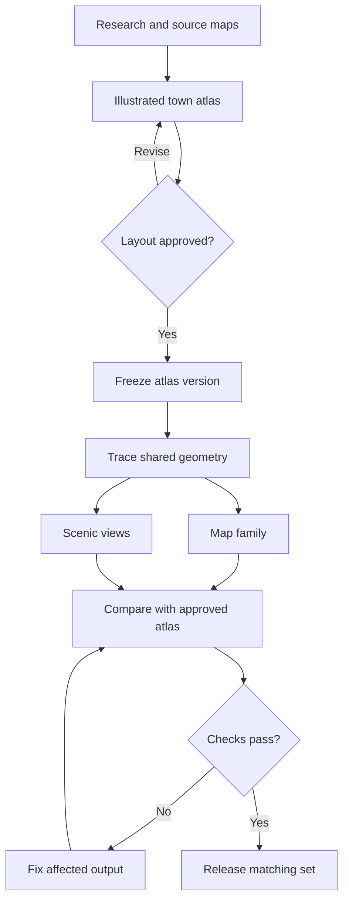

# Faerûn Cartographers: Atlas-First Workflow

Version 1.0 · 30 October 2026

**Build and refine the illustrated town atlas first. Approve its layout before making the other map types.**

The atlas is the visual checkpoint for the whole settlement. Research supplies the facts; the approved atlas records the chosen working layout. Approval does not turn assumed details into established lore.

## Workflow

## 1. Gather the sources

Collect the research, source maps, named places, reference date and any measured distances or heights. Read the relevant style skill and the current Faerûn Cartographers Plat Standard before composing a plate.

Record which source controls each fact. Keep official source claims, user choices and assumptions distinct. If maps disagree about a river, bridge, gate or landmark, show the conflict and resolve it before treating the layout as settled.

**Output:** source list, place index and short list of gaps.

## 2. Create the illustrated town atlas

Use Fantasy Illustrated Town Atlas to produce the first full visual draft. Keep the source river shape, roads, crossings, walls, gates and named places. Set north, scale, map extent and the standard frame.

Fill the full intended map area. If this requires more countryside than the source shows, record the added ground as assumed. Check the amount and size of housing against the stated population; a roof count alone does not establish capacity.

**Output:** illustrated atlas draft. Do not start the other map types yet.

## 3. Refine the atlas

Review and edit the atlas until the overall place works:

- River course, banks, islands and connections.
- Number, position and landing points of bridges.
- Wall outline, gates and roads through them.
- Streets, junctions, market spaces and access.
- Named buildings and which bank they stand on.
- Building density, footprints and open ground.
- Fields, woods and the full map extent.
- Labels, numbered key, north and supported scale.
- Standard frame, fonts, round seal, compass and square grid.

Use the original sources to check facts during each revision. Fix layout errors here rather than letting later styles copy them.

**Checkpoint:** the user approves a specific atlas version. If approval was already given for that version, continue without asking again. A request to build the next style is not a reason to ignore an unresolved layout error.

## 4. Freeze the approved layout

Keep the approved atlas unchanged and assign a clear version, such as `everlund-atlas-v1`.

Record the source filename, map bounds, crop, orientation, scale evidence, landmark IDs and unresolved assumptions. Later maps use this version as their common visual reference. Do not silently replace it with the latest generated image.

**Output:** approved atlas and layout record.

## 5. Build shared geometry from the approved atlas

Use Fantasy Land-Water Boundary Master and Map Geometry Master to trace:

| Layer | Contents |
| --- | --- |
| Land and water | Riverbanks, water polygons, confirmed islands and land connections |
| Transport | Road lines, junctions, bridges and their endpoints |
| Built plan | Building footprints, walls, towers, gates and docks |
| Places | Stable IDs and positions for named sites |
| Land cover | Fields, woods and open spaces supported by the approved plan |
| Terrain | Measured heights, or a separate clearly marked assumed terrain layer |

Keep boats, bridges, piers and walls separate from land and water. Water must continue beneath bridges.

Compare traced layers with the approved atlas using overlays. Save a lossless water mask, editable geometry and the layout record. Record the parent atlas version in each file.

**Checkpoint:** shared layers match the approved atlas. If only image conversion is available, label the result approximate; do not claim exact alignment.

## 6. Create map types from the shared base

Each map starts from the approved atlas and its matching geometry. Do not use a chain of restyled images as the source of truth.

| Map type | Added treatment | Evidence rule |
| --- | --- | --- |
| Land–water | Flat land and water fills | Keep banks and connections fixed |
| GIS cadastral | Footprints, lots and land-use colors | Mark unknown property lines as assumed |
| Black ink reference | Plain overhead linework | Keep buildings, roads and landmarks in place |
| City districts | Light district colors and labels | Use sourced borders or label proposals |
| Topographic survey | Terrain contours | Numeric intervals require height data |
| Hypsometric elevation | Relative height colors | Without height data, mark conceptual and omit numeric bands |
| Colored property topography | Property plan plus terrain | Use the same approved property and terrain layers |
| Illustrated variants | Different ink, paint or roof treatment | Change appearance without changing layout |

A combined map may use approved component layers, but those layers must share the same atlas version, crop and scale.

## 7. Create scenic views

Choose and record the camera location, facing direction, eye height and field of view before rendering. Use the approved city geometry to establish what lies in front of what.

Allow buildings to hide other buildings. Do not move a landmark to make it visible. Check bridge count, riverbanks and which side of the water holds each site. Mark building heights and facade details as artistic estimates unless supplied by sources.

Ground-level and lookout scenes do not need the full plat frame unless requested.

## 8. Check and release the set

Compare each output with the approved atlas and shared geometry. Check the river, crossings, street connections, gates, landmarks, building density, crop and scale. For plates, check the current Plat Standard, including square grid cells and the scale bar.

Fix a style error in the affected output. If the working geography itself needs to change, revise the atlas, record a new approved version, update the shared layers, and rebuild affected outputs. Never patch only one map's river or road.

Deliver each map with its parent atlas version and a brief note on assumptions. Claim exact geometry only where it was actually traced and checked.

## Reusable task prompt

> Follow the Faerûn Cartographers Atlas-First Workflow for [location]. Read the supplied research and source maps. Create and refine the illustrated town atlas first, using the current Plat Standard. Check riverbanks, bridges, walls, gates, roads, landmarks, building density and full map extent. Use the approved atlas version as the working layout, keeping sourced facts separate from assumptions. Then trace and check shared geometry. Build requested map styles from that common base, not from a chain of generated images. Mark unmeasured terrain, unknown parcels and proposed districts clearly. For scenic views, state the camera position and direction and preserve sightlines. If a layout change is needed, update the atlas and affected outputs together.

